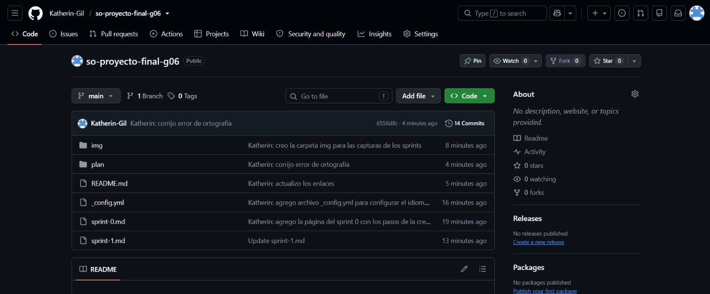
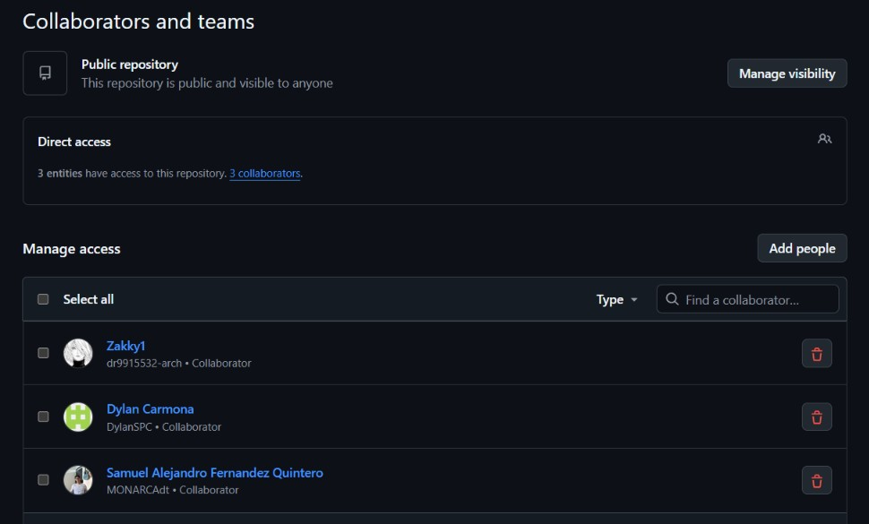
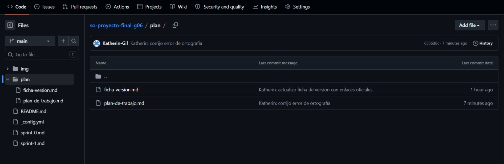
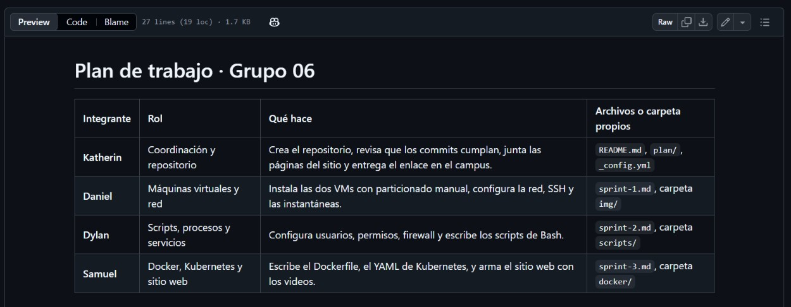
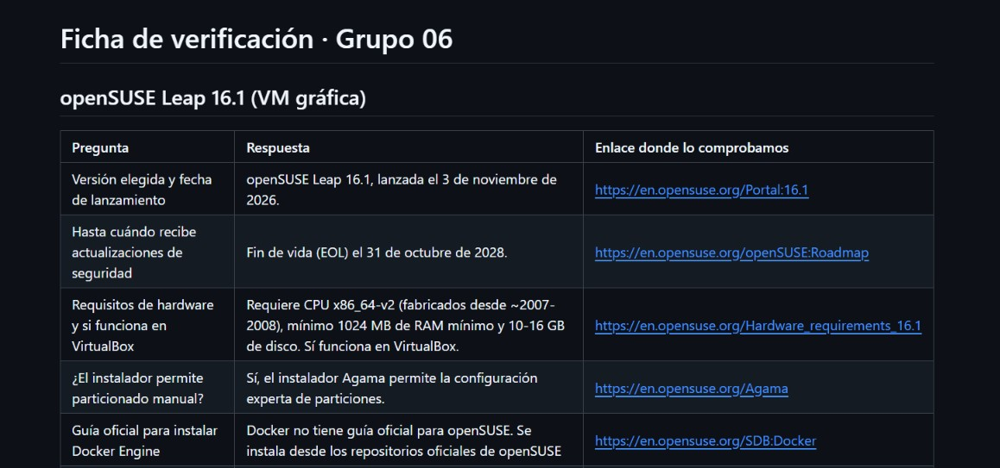

# Sprint 0 · Arranque, paso a paso

> Página del Sprint 0 del Grupo 06. Aquí documentamos la creación del repositorio base del proyecto. [Volver al inicio](./)

- **Qué se entrega:** el enlace de un repositorio público de GitHub que tenga una carpeta `plan` con los archivos: `plan-de-trabajo.md` y `ficha-version.md`.
- **Dónde se entrega:** en el campus, solo el enlace. Sin video ni commits obligatorios.
- **Cierre:** jueves 19 de noviembre y viernes 20 de noviembre, 11:55 p. m.

## Paso 1. Crear la cuenta y el repositorio

1. Creamos la cuenta en https://github.com/.
2. Pulsamos el botón **+** de arriba a la derecha y elegimos **New repository**.
3. Le pusimos el nombre `so-proyecto-final-g06`.
4. Lo marcamos como **Public**.
5. Pulsamos **Create repository**.

**[Captura 1: Creación del repositorio en GitHub]**

Todos los integrantes necesitan acceso para hacer commits: la coordinadora los agregó en **Settings → Collaborators**.

**[Captura 2: Lista de colaboradores del repositorio]**

## Paso 2. Crear la carpeta plan y los archivos

Creamos la carpeta `plan` y dentro de ella subimos los dos archivos `.md` que pide el proyecto.

**[Captura 3: La carpeta plan en el repositorio con los archivos]**
   

## Paso 3. Verificar el plan de trabajo

El archivo `plan/plan-de-trabajo.md` contiene la tabla con los roles de cada integrante, los archivos que son suyos y las fechas de cierre de los sprints.

**[Captura 4: Verificar el plan de trabajo en GitHub]**

## Paso 4. Verificar la ficha de versión

El archivo `plan/ficha-version.md` contiene la verificación de las distribuciones asignadas (openSUSE Leap, Debian y AlmaLinux), con sus respectivos enlaces oficiales.

**[Captura 5: Verificar la ficha de versión en GitHub]**

## Lo que hizo cada integrante en este sprint

> **Nota:** Los commits individuales y la participación por integrante se empiezan a registrar formalmente a partir del Sprint 1, como lo indica el documento del proyecto.  

