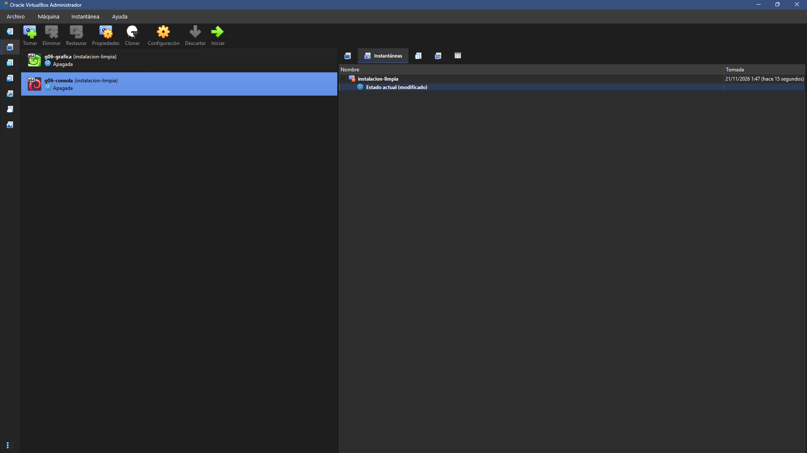

# Sprint 1 · Montaje

> Página del Sprint 1 del grupo 06. Aquí documentamos lo que hicimos, los comandos usados y las capturas. [Volver al inicio](./)

- **Qué se pide en este sprint (5 puntos):** VM gráfica, VM de consola, red, SSH e instantáneas.
- **Qué se entrega en el campus:** el enlace de este sitio.
- **Qué más:** el video de 3 minutos (al final de esta página), 2 commits por integrante y el archivo `codigo_sprint1.txt` en el home del usuario principal de las dos VMs.

## 1. VM gráfica (g06-grafica)

Instalamos **openSUSE Leap 16.1** con particionado manual: `/`, swap y `/home`. No usamos «borrar el disco».

| Partición | Tamaño | Por qué |
| :--- | :--- | :--- |
| / | 15 GB | El sistema y los programas de openSUSE, con margen para actualizar |
| swap | 2 GB | Igual a la RAM de la VM, por si falta memoria |
| /home | 8 GB | Los archivos de los usuarios, separados del sistema |

Dos navegadores y dos editores instalados: **Firefox** y **Chromium** (navegadores), **nano** y **Kate** (editores de texto).

Comandos: `date`, `lsblk`, `df -h`, `cat /etc/fstab`

* **Particionado durante la instalación (`g06-grafica`):**
  

* **Verificación de particiones (`daniel@g06-grafica`):**
  
  
  

* **Navegadores y editores abiertos al mismo tiempo:**
  

## 2. VM de consola (g06-consola)

Instalamos **Debian 13.7** con particionado manual: `/`, `/var`, swap y `/home`. Disco de 25 GB y 2 CPU.

| Partición | Tamaño | Por qué |
| :--- | :--- | :--- |
| / | 5 GB | El sistema base de Debian, sin entorno gráfico |
| /var | 12 GB | Docker guarda sus imágenes en /var/lib/docker (necesita espacio) |
| swap | 2 GB | Para evitar problemas de memoria |
| /home | 6 GB | Para los archivos de los scripts y el usuario principal |

Herramientas instaladas: make, rsync, curl, git y wget.

Comandos: `date`, `lsblk`, `df -h`, `cat /etc/fstab`, `make --version`, `rsync --version`, `curl --version`, `git --version`, `wget --version`

* **particion durante la instalación (`g06-consola`):**
  

* **Verificación de particiones en terminal (`daniel@g06-consola`):**
  

**[Captura 5: las cinco herramientas mostrando su versión]**

## 3. Red

Cada VM tiene dos adaptadores: el 1 en NAT (internet) y el 2 en red solo-anfitrión (para verse entre ellas).

Comandos: `ip a` en cada VM y `ping` en los dos sentidos.

* **Direcciones IP en ambas VMs (`ip a`):**
  
  

* **Pruebas de red (`ping`):**
  
  

## 4. SSH

Entramos por SSH desde la VM gráfica (`g06-grafica`) a la VM de consola (`g06-consola`).

Comando: `ssh daniel@192.168.56.102`

## 5. Instantáneas

Una por VM, llamada `instalacion-limpia`, tomada con la VM apagada y la instalación terminada.

## Código del sprint

El docente publicó el código en el campus 48 horas antes del cierre. Lo guardamos en las dos VMs y lo mostramos en el video.

Comandos: `echo "XX00-AB12" > codigo_sprint1.txt`, `cat codigo_sprint1.txt` y `date`

## Video del sprint (3 minutos)

Pantalla continua y sin cortes. Cada integrante muestra su parte, dice su nombre y qué hizo en los primeros 10 segundos, y aparece su cara.

[Enlace del video de YouTube aquí]

## Lo que hizo cada integrante en este sprint

| Integrante | Qué hizo | Commits |
| :--- | :--- | :--- |
| Katherin | Creó las páginas del sitio, la plantilla y revisó la ficha | 1 |
| Daniel | Instaló openSUSE Leap y Debian, configuró la red, SSH, las instantáneas y subió las capturas | 3 |
| Dylan | Instaló las herramientas en Debian, grabó el video y completó las validaciones | [Número] |
| Samuel | [Qué hizo] | [Número] |
